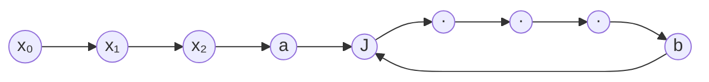
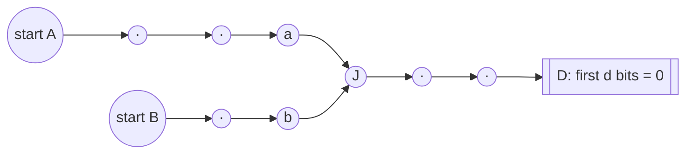
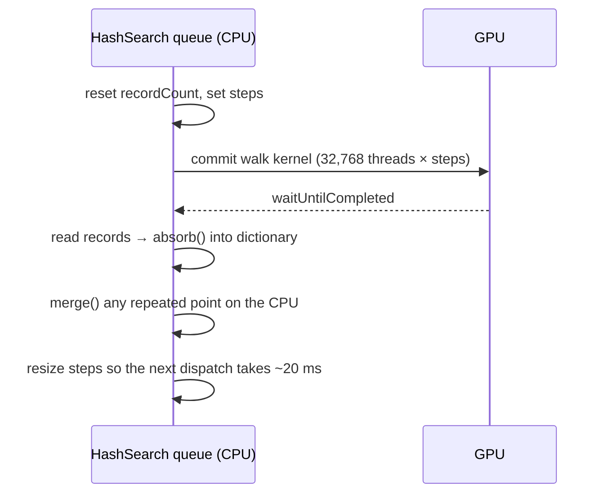

# How Hasha finds collisions

This document explains how the collision search works, from the maths down to the Metal GPU code. It follows the code in `Hasher/Model`:

| File | What it does |
|---|---|
| `HashComputer.swift` | `Point` (a 256-bit value), `HashStep` (the function we walk), `Collision` |
| `DistinguishedPointSearch.swift` | The search algorithm and the CPU walkers |
| `GPUWalker.swift` | Sets up Metal and runs walkers on the GPU |
| `Walk.metal` | The GPU code: SHA-256 and the walk loop |
| `HashSearch.swift` | Runs the search off the main thread, publishes progress, saves state |

## 1. The problem

A **collision** is two different inputs `a ≠ b` with `SHA-256(a) == SHA-256(b)`. No full SHA-256 collision has ever been found, and with today's hardware none will be. So the app lets you pick how many leading bits of the hash must match (24 to 256). It is the same problem at a size you can actually finish.

The step function is:

```
f(x) = first n bits of SHA-256(salt0 ‖ salt1 ‖ x)
```

- `x` is a `Point`: 256 bits stored as four `UInt64` words, `w0` (highest bits) to `w3`. Only the first `n` bits are ever non-zero.
- The message is always 48 bytes: two 8-byte salts and the 32-byte `x`, all big-endian.
- The **salt** is random per search. It makes each search find a different collision, and it means a found pair is a genuine collision of real SHA-256 inputs. The app displays the full digests so you can check the first `n` bits match.

Because `f` maps n-bit values to n-bit values, we can feed its output back in as its next input. That is what makes the algorithms below possible.

### How many hashes does it take?

By the **birthday bound**, among random n-bit values you expect the first repeat after about

```
√(π/2 · 2ⁿ)  ≈  1.25 · 2^(n/2)  hashes
```

| Bits | Expected hashes | At ~540M hashes/s (Mac GPU) |
|---|---|---|
| 32 | 82 thousand | instant |
| 48 | 21 million | < 0.1 s |
| 64 | 5.4 billion | ~10 s |
| 80 | 1.4 trillion | ~45 min |
| 128 | 2.3 × 10¹⁹ | ~1,400 years |
| 256 | 4.3 × 10³⁸ | ~10²² years |

The naive alternative, hashing two fresh random inputs and comparing them, needs about 2ⁿ tries instead of 2^(n/2). For 64 bits that is 4 billion times more work. The birthday bound is the whole reason this is feasible at all.

## 2. Pollard's rho: finding a collision without storing hashes

Remembering every hash in a table reaches the birthday bound but needs memory for billions of entries. Instead, walk the chain

```
x₀ → f(x₀) → f(f(x₀)) → …
```

There are only 2ⁿ possible values, so the chain must eventually repeat a value. After that it loops forever. Drawn out, the path looks like the Greek letter ρ (rho):



`J` is where the tail joins the loop. It has two different predecessors: `a` on the tail and `b` at the end of the loop. So `f(a) = f(b) = J` with `a ≠ b`. That is the collision.

A cycle-finding algorithm (Floyd's or Brent's) detects the loop with constant memory: it only remembers a couple of points, not the path. Then a second pass from `x₀` finds `J`. The expected walk length is still about the birthday bound.

The limitation is that one chain is inherently sequential: each step needs the previous result. It can only use one CPU core. The next section fixes that.

## 3. Distinguished points: many walkers at once

This is the algorithm the app actually runs (van Oorschot & Wiener, 1994). Many walkers each step their own chain, and they only need to share a small table.

### The idea

1. Call a value **distinguished** if its first `d` bits are zero (`dpBits` in the code). On average one in 2^d values is distinguished.
2. Each walker starts at a random point and steps `x → f(x)` until it hits a distinguished point. It records `(distinguished point, start, length)` and restarts from a new random point.
3. All walkers share one dictionary from distinguished point to `(start, length)`.

The key fact is that `f` is deterministic. If two trails ever pass through the same value, they follow the identical path from then on, so they reach the **same distinguished point**:



When a second trail reports `D`, the dictionary already has an entry for `D`, and we know two trails merged somewhere before it.

### Finding the merge (`merge` in `DistinguishedPointSearch.swift`)

1. Advance the longer trail's start until both trails are the same number of steps away from `D`.
2. Step both together. The first step where `f(x) == f(y)` is the merge `J`, and `(x, y)` is the collision.

This re-walk costs about the length of one trail, which is tiny compared to the whole search.

### False alarms

Sometimes one trail's start lies *on* the other trail. Both reach `D`, but there was no merge from two different values. After the lengths are lined up, both pointers land on the same value, so `merge` returns `nil`. The search counts this in `falseAlarms`, keeps the longer of the two trails and carries on.

### Trails that never finish

A walker can fall into a loop that contains no distinguished point. Every trail is abandoned after `maxTrailLength = 20 · 2^d` steps. Trails average 2^d steps, so a genuine trail almost never gets that long.

### Choosing `d`

`d` trades memory against wasted work:

- **Larger `d`:** fewer points stored (about `hashes / 2^d`), but longer trails. After two trails merge, the search only notices once the second trail reaches `D`, so the work in between is wasted.
- **Smaller `d`:** a merge is noticed quickly, but more points must be stored.

The code aims for trails much shorter than each walker's share of the total work:

```swift
dpBits = clamp(bits/2 − ceil(log2(walkers)) − 4, 0, 28)
```

For the GPU's 32,768 walkers the minimum is 10. Shorter trails would report so many points that the CPU could not keep up.

Example: a 64-bit search on the GPU uses `d = 13`. About 5.4 billion hashes report roughly 660,000 distinguished points, a few tens of megabytes. That is small enough to store and to save when the app pauses.

## 4. CPU walkers

`DistinguishedPointSearch.run(seconds:)` runs one walker per CPU core:

- The number of walkers comes from `ProcessInfo.processInfo.activeProcessorCount`, read at runtime. For example, an iPhone 15 Pro has 6 cores; a Mac has more.
- `DispatchQueue.concurrentPerform` runs one iteration per walker on separate threads and waits until all of them finish.
- Each walker writes only to its own slot in three arrays (trails, found points, hash counts), through `UnsafeMutableBufferPointer`. No locks are needed while walking.
- After the round, `absorb` adds the found points to the dictionary on one thread and checks each one for a merge.

Hashing uses CryptoKit's `SHA256` (hardware-accelerated). On a Mac, all cores ran about 5.8× faster than one core in a release build.

## 5. GPU walkers with Metal

### What Metal is

Metal is Apple's API for programming the GPU, on both iPhone and Mac. It can draw graphics, but it can also run **compute kernels**: ordinary functions run by thousands of GPU threads at once. Kernels are written in the **Metal Shading Language (MSL)**, which is close to C++.

A GPU has many simple cores and runs tens of thousands of threads. Distinguished points suit it perfectly: each thread is one independent walker, and threads never need to talk to each other except to append a found point.

CryptoKit does not run on the GPU, so `Walk.metal` contains its own SHA-256. It is a single 64-round compression of one block, since the 48-byte message plus padding always fits in one 64-byte block. The test `testGPUStepMatchesCPUExactly` checks it gives exactly the same results as CryptoKit at several bit lengths.

### The Metal objects used

`GPUWalker.init` builds these once per search:

| Metal API | What it is | Used for |
|---|---|---|
| `MTLCreateSystemDefaultDevice()` → `MTLDevice` | The GPU | Everything else is made from it; `nil` means no GPU, so the "Use GPU" toggle is hidden |
| `device.makeLibrary(source:options:)` → `MTLLibrary` | Compiled GPU code | Compiles `Walk.metal` at runtime (see below) |
| `library.makeFunction(name:)` → `MTLFunction` | One kernel | `walk` and `hashPoints` |
| `device.makeComputePipelineState(function:)` → `MTLComputePipelineState` | A kernel ready to run | One per kernel |
| `device.makeCommandQueue()` → `MTLCommandQueue` | Queue of GPU work | Submits each dispatch |
| `device.makeBuffer(length:options: .storageModeShared)` → `MTLBuffer` | Memory the GPU can read and write | Parameters, walker state, results, counter |

Each round of work (`GPUWalker.run`) then uses:

| Metal API | Used for |
|---|---|
| `queue.makeCommandBuffer()` → `MTLCommandBuffer` | One batch of GPU work |
| `commands.makeComputeCommandEncoder()` → `MTLComputeCommandEncoder` | Records which kernel to run, with which buffers |
| `encoder.setComputePipelineState`, `encoder.setBuffer(_:offset:index:)` | Picks the `walk` kernel and binds buffers to `[[buffer(0…3)]]` in the kernel |
| `encoder.dispatchThreadgroups(_:threadsPerThreadgroup:)` | Launches 32,768 threads in groups of 256 |
| `commands.commit()`, `commands.waitUntilCompleted()` | Sends the work and waits for it (on the search's background queue, never the main thread) |
| `commands.gpuStartTime`, `commands.gpuEndTime` | Measures how long the GPU took, to size the next dispatch |

**Shared memory.** iPhones and Apple Silicon Macs have *unified memory*: the CPU and GPU use the same RAM. With `.storageModeShared`, the CPU reads and writes a buffer through `buffer.contents()` directly, with no copies to or from the GPU.

**Runtime compilation.** Normally Xcode compiles `.metal` files at build time. Recent Xcode versions need a separately downloaded Metal Toolchain for that, which would break builds and CI that don't have it. Instead, `Walk.metal` is copied into the app as a plain resource file. `GPUWalker` reads its source and compiles it with `makeLibrary(source:)` the first time the GPU is used, which takes about 100 ms. A side effect: a mistake in the shader shows up when the app runs, not when it builds. The GPU tests catch that.

### GPU memory layout

All buffers are arrays of 32-bit words (`uint`). Each 256-bit point is 8 words, big-endian, matching `Point`'s `w0…w3`.

| Buffer | Index | Layout |
|---|---|---|
| `trails` | 0 | 32,768 walkers × 20 words: `start[0…7]`, `current[8…15]`, `length` (2 words), RNG state (2 words) |
| `records` | 1 | Up to 65,536 found points × 18 words: `point[0…7]`, `start[8…15]`, `length` (2 words) |
| `recordCount` | 2 | One `atomic_uint`: how many records were written in this dispatch |
| `params` | 3 | `salt[0…3]`, `bits`, `dpBits`, `steps`, record capacity, `maxTrailLength` (2 words) |

Walker state stays in GPU memory between dispatches. The CPU only reads `records`.

### The `walk` kernel

Every thread runs this, with `tid` (its thread number) choosing its walker:

```
load my trail (start, current, length, rng) from trails[tid]
repeat `steps` times:
    next = first `bits` bits of SHA-256(salt ‖ current)
    length += 1
    if next is distinguished:
        slot = atomic_fetch_add(recordCount, 1)      // reserve a unique output slot
        if slot < capacity: write (next, start, length) to records[slot]
        restart from a random point
    else if length ≥ maxTrailLength:
        restart from a random point
    else:
        current = next
save my trail back to trails[tid]
```

- **The atomic counter** is the only point where threads interact. `atomic_fetch_add` hands each thread a different slot, so no two threads write the same record.
- **Random restarts** use splitmix64, a small fast random generator, seeded per walker from the CPU. GPU code has no system random-number API.
- **If records overflow** (more than 65,536 points in one dispatch), extra points are dropped. That loses a little work but never gives a wrong answer. The CPU then halves the next dispatch.

### Each round on the CPU side



- **Adaptive dispatch size.** `steps` is rescaled after each dispatch so it takes about 20 ms of GPU time, capped at 4,096 steps. Short dispatches keep the UI smooth and stop iOS from treating the app as hogging the GPU.
- **The CPU does the bookkeeping.** The dictionary and `merge` stay on the CPU. They run once per found point, which is rare (one per 2^d hashes), so the CPU easily keeps up.
- **Pausing** loses only the trails in flight, a fraction of a second of work. All stored distinguished points are kept.

In the simulator, which runs on the Mac's GPU, this ran at about 537 million hashes per second, roughly 23× the Mac's CPU. A 48-bit collision took under a second. iPhone GPUs are smaller, so expect lower numbers there.

## 6. Running it in the app (`HashSearch.swift`)

`HashSearch` is the `ObservableObject` the SwiftUI view watches.

- **One background queue.** All search work runs on a private serial `DispatchQueue`, never on the main thread. Each batch runs for about 50 ms, then queues the next batch rather than looping. That way a pause or a new search gets a turn on the queue between batches.
- **Generation counter.** Every start, pause and new search increments a counter, protected by an `NSLock`. A batch only continues, and only updates the UI, if its generation is still the current one. This makes rapid start/pause safe: batches left over from an earlier run quietly stop.
- **Main-thread updates.** Progress (hash count, stored points, rate) is published on the main thread, as SwiftUI requires.
- **CPU and GPU share one search.** Both feed the same `DistinguishedPointSearch`, so you can switch between them while paused. When a GPU exists, the search uses the GPU's `dpBits` for CPU walkers too.
- **Saving.** On pause, when a collision is found, and when the app leaves the foreground, the search (salt, walkers, stored points, counts) is encoded with `Codable` as a binary property list into `UserDefaults`. On launch it is restored, so a long search continues where it left off.

## 7. Tests (`HasherTests.swift`)

The tests check that:

- The step function matches CryptoKit, and the GPU's SHA-256 matches the CPU bit for bit.
- Real collisions are found at 24, 32 and 40 bits on the CPU, and at 48 bits on the GPU.
- `merge` finds the junction and rejects false alarms.
- Trails reported by the GPU are valid: replaying one on the CPU reaches its point at exactly its first distinguished step.
- A search saved and restored mid-way still finds a collision.
- Rapid start/pause leaves no work running, and `HashSearch` is released from memory (no leak).

They pass with Thread Sanitizer enabled, which detects data races between threads.

## Further reading

- Paul C. van Oorschot and Michael J. Wiener, *Parallel Collision Search with Cryptanalytic Applications*, Journal of Cryptology, 1999. The original distinguished-points paper.
- Richard P. Brent, *An Improved Monte Carlo Factorization Algorithm*, BIT, 1980. Brent's cycle detection.
- Marc Stevens et al., *The First Collision for Full SHA-1* (SHAttered), CRYPTO 2017. A real collision attack on a hash function, using GPUs at scale.
- Apple, [Metal documentation](https://developer.apple.com/documentation/metal), especially "Performing Calculations on a GPU".
